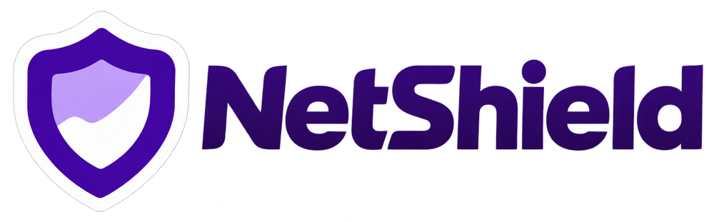
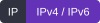
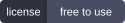

<div align="center">
  <picture>
    <source media="(prefers-color-scheme: dark)" srcset="NetShield/Editor/Art/NetShieldLogoDark.png">
    
  </picture>

  <h3>VPN, Proxy &amp; Tor Detection &amp; Blocking</h3>
  <p>IP classification and configurable connection responses for Unity.</p>
  <p>
    
    
    
    
  </p>
  <p><a href="https://netshield.katzulabs.com/">Documentation</a> &nbsp; | &nbsp; <a href="https://github.com/PuddinWorks/NetShield">GitHub</a> &nbsp; | &nbsp; <a href="https://katzulabs.com/discord">Discord</a></p>
</div>

## Overview

NetShield is a standalone IP detection toolkit for Unity. Identify known VPNs, public proxies, Tor exit nodes, hosting networks and custom IP ranges. Choose whether to simply inspect the result or respond using the built-in manager.

No paid detection API, subscription or multiplayer networking package is required. IP classification happens locally using cached or imported data.

## Features

| | Feature | Description |
| :--: | :-- | :-- |
| 🛡️ | Detection | IPv4, IPv6 and CIDR support, provider and category switches. |
| ⚙️ | Configuration | Dockable editor with Config, API and Third-Party tabs. |
| 🎮 | Responses | Log, toggle objects, quit the game, invoke UnityEvents or load a scene. |
| 🔄 | Monitoring | Startup and continuous checks, delays, cooldowns and custom rules. |
| 🗂️ | Database | Automatic refresh, offline mode, source controls, custom imports, backups and search. |
| 💻 | Developer API | Check supplied IPs synchronously or asynchronously without a scene manager. |

## Getting started

1. [Download the repository as a ZIP](https://github.com/PuddinWorks/NetShield/archive/refs/heads/main.zip) or clone it.
2. Copy the **NetShield** folder into your Unity project's `Assets` folder.
3. Open **Tools > NetShield** and select **Add NetShield to scene** if you want automatic local monitoring.
4. Review the Third-Party tab, enable appropriate sources and update the database, or import your own IP ranges.
5. Configure your detection switches and actions. Use the IP tester to check an address without executing actions.

> No IP database is shipped in this repository. Public-IP discovery is optional and off by default. Offline mode prevents external updates and lookups.

## Quick API example

```csharp
using NetShield;
using UnityEngine;

public class ConnectionExample : MonoBehaviour
{
    public void CheckConnection(string ip)
    {
        var result = NetShieldAPI.CheckIP(ip);

        if (result.Detected)
            Debug.Log(string.Join(", ", result.activeMatches));
        else if (!result.complete)
            Debug.Log("Detection data is incomplete.");
    }
}
```

For an asynchronous check that may refresh the enabled sources:

```csharp
var result = await NetShieldAPI.CheckIPAsync(playerIp);
```

These methods return information without executing manager actions. Developers supply trusted remote IP addresses and implement their own multiplayer enforcement. An incomplete or unmatched result is not proof that a connection is safe.

## Documentation

- [Online documentation](https://netshield.katzulabs.com/)
- [Installation and configuration](NetShield/README.md)
- [API reference](NetShield/Documentation/API.md)
- [Third-party sources and notices](NetShield/Third-Party%20Notices.txt)

## Compatibility

Designed for Unity 2021.3 LTS and newer. Unity compilation, player platform and IL2CPP compatibility have not yet been independently verified. No networking framework integrations are included. Detection coverage depends on the available data and is not guaranteed to identify every VPN or proxy.

## License

NetShield is free to use, modify and share in personal or commercial projects. You may not sell NetShield itself or change its branding. See [LICENSE](LICENSE) for the complete custom license. External datasets remain subject to their own licenses.

<div align="center">
  
  <p>NetShield - PuddinWorks</p>
</div>
